# Modelo de datos propuesto — Pelucars

Estado: diseño para revisión, 17 de noviembre de 2026. Este documento no crea tablas, migraciones, SQL, RLS, usuarios ni datos. El destino previsto es PostgreSQL de Supabase; no se realizó ninguna conexión. Las reglas que necesitan confirmación se identifican en [decisiones.md](decisiones.md).

## Conceptos y límites

- **Cliente:** identidad comercial persistente. Puede tener muchas consultas y muchas compras.
- **Oportunidad / consulta:** una intención comercial individual de ese cliente. No equivale a un mensaje ni necesariamente a una conversación completa. Cuándo abrir otra consulta o reabrir una existente sigue pendiente.
- **Conversación:** hilo de comunicación por canal. Puede atravesar varias oportunidades del mismo cliente; los mensajes se conservan una sola vez.
- **Mensaje:** unidad de comunicación con emisor identificado. Un mensaje no incrementa automáticamente el contador de consultas o recontactos.
- **Actividad:** nota o tarea del vendedor, incluido un recontacto programado. **Intento de recontacto:** acción de contacto efectivamente realizada, con resultado; puede producir cero, uno o varios mensajes. Programar, reprogramar o cancelar una tarea no crea un intento.
- **Recepción inicial:** episodio que delimitará el futuro máximo de tres mensajes salientes del bot. Su frontera temporal y los casos de reingreso necesitan definición; no se usa el total de mensajes del cliente como sustituto.
- **Compra:** operación histórica independiente del estado actual de una oportunidad o del inventario. No se elimina al cerrar una consulta ni al dar de baja un vehículo.

Los vehículos serán administrados desde el frontend y guardados en Supabase como fuente de verdad interna. La existencia de una API externa no implica sincronización, consulta ni dependencia de ella.

## Diagrama entidad-relación

Los atributos muestran claves principales; el diccionario siguiente especifica el resto. Las relaciones opcionales se indican con `o|` u `o{`.

```mermaid
erDiagram
  IDENTIDAD_AUTH ||--o| PERFILES : identifica
  PERFILES ||--o{ USUARIO_ZONA : integra
  ZONAS ||--o{ USUARIO_ZONA : agrupa
  ZONAS o|--o{ CLIENTES : referencia
  ZONAS o|--o{ OPORTUNIDADES : corresponde
  CLIENTES ||--o{ CONTACTOS_CLIENTE : posee
  CLIENTES ||--o{ OPORTUNIDADES : consulta
  CLIENTES ||--o{ CONVERSACIONES : mantiene
  OPORTUNIDADES ||--o{ OPORTUNIDAD_CONVERSACION : vincula
  CONVERSACIONES ||--o{ OPORTUNIDAD_CONVERSACION : incluye
  CONVERSACIONES ||--o{ MENSAJES : contiene
  OPORTUNIDADES o|--o{ MENSAJES : contextualiza
  CLIENTES o|--o{ MENSAJES : envia
  PERFILES o|--o{ MENSAJES : envia
  CONVERSACIONES ||--o{ RECEPCIONES : recibe
  OPORTUNIDADES ||--o{ RECEPCIONES : origina
  RECEPCIONES o|--o{ MENSAJES : agrupa
  OPORTUNIDADES ||--o{ INTERESES_VEHICULO : expresa
  VEHICULOS ||--o{ INTERESES_VEHICULO : interesa
  MONEDAS ||--o{ VEHICULOS : cotiza
  MONEDAS o|--o{ OPORTUNIDADES : presupuesta
  ESTADOS_OPORTUNIDAD ||--o{ OPORTUNIDADES : clasifica
  PERFILES o|--o{ OPORTUNIDADES : responsable_actual
  OPORTUNIDADES ||--o{ HISTORIAL_ASIGNACIONES : registra
  PERFILES o|--o{ HISTORIAL_ASIGNACIONES : responsable_o_autor
  OPORTUNIDADES ||--o{ HISTORIAL_ESTADOS : registra
  ESTADOS_OPORTUNIDAD ||--o{ HISTORIAL_ESTADOS : destino
  PERFILES o|--o{ HISTORIAL_ESTADOS : autor
  OPORTUNIDADES ||--o{ EVALUACIONES_SCORE : evalua
  EVALUACIONES_SCORE ||--o{ EVIDENCIAS_SCORE : justifica
  MENSAJES ||--o{ EVIDENCIAS_SCORE : fundamenta
  OPORTUNIDADES ||--o{ ACTIVIDADES : planifica
  PERFILES ||--o{ ACTIVIDADES : autor_y_responsable
  OPORTUNIDADES ||--o{ INTENTOS_RECONTACTO : recibe
  ACTIVIDADES o|--o{ INTENTOS_RECONTACTO : origina
  PERFILES ||--o{ INTENTOS_RECONTACTO : realiza
  INTENTOS_RECONTACTO ||--o{ RECONTACTO_MENSAJE : vincula
  MENSAJES ||--o| RECONTACTO_MENSAJE : documenta
  CLIENTES ||--o{ COMPRAS : realiza
  OPORTUNIDADES o|--o{ COMPRAS : convierte
  PERFILES o|--o{ COMPRAS : registra
  MONEDAS ||--o{ COMPRAS : expresa
  COMPRAS ||--|{ COMPRA_ITEMS : contiene
  VEHICULOS o|--o{ COMPRA_ITEMS : referencia

  PERFILES { uuid id PK }
  ZONAS { uuid id PK }
  USUARIO_ZONA { uuid id PK }
  CLIENTES { uuid id PK }
  CONTACTOS_CLIENTE { uuid id PK }
  OPORTUNIDADES { uuid id PK }
  ESTADOS_OPORTUNIDAD { text codigo PK }
  MONEDAS { char codigo PK }
  VEHICULOS { uuid id PK }
  INTERESES_VEHICULO { uuid oportunidad_id PK,FK
    uuid vehiculo_id PK,FK }
  CONVERSACIONES { uuid id PK }
  OPORTUNIDAD_CONVERSACION { uuid oportunidad_id PK,FK
    uuid conversacion_id PK,FK }
  RECEPCIONES { uuid id PK }
  MENSAJES { uuid id PK }
  EVALUACIONES_SCORE { uuid id PK }
  EVIDENCIAS_SCORE { uuid id PK }
  ACTIVIDADES { uuid id PK }
  INTENTOS_RECONTACTO { uuid id PK }
  RECONTACTO_MENSAJE { uuid mensaje_id PK,FK }
  HISTORIAL_ASIGNACIONES { uuid id PK }
  HISTORIAL_ESTADOS { uuid id PK }
  COMPRAS { uuid id PK }
  COMPRA_ITEMS { uuid id PK }
```

## Convenciones del diccionario

`?` significa nullable; los demás campos son obligatorios. `PK` es clave primaria, `FK` clave foránea, `UQ` unicidad. Todas las tablas con `id` usan UUID PK, salvo la identidad externa, cuya clave pertenece al proveedor futuro. Todas las tablas de dominio incorporan `creado_en timestamptz`; las editables incorporan además `actualizado_en timestamptz`. Las tablas puente sólo requieren `creado_en`, salvo `usuario_zona`, que conserva vigencia. Los eventos, mensajes, evaluaciones, evidencias y compras históricas se proponen inmutables, con correcciones explícitas y auditadas en la etapa futura.

Fechas en UTC mediante `timestamptz`; presentación local en America/Buenos_Aires. Importes en `numeric(14,2)`, nunca punto flotante. Moneda explícita en toda cantidad monetaria. `text` con valores controlados significa catálogo/restricción futura, no un enum instalado. Las FK no implican borrados en cascada.

### Identidad, roles y zonas

| Tabla | Campos propuestos y claves | Relaciones / restricciones |
| --- | --- | --- |
| `perfiles` | `id uuid PK/FK → identidad_auth.id`; `nombre text`; `rol text`; `activo boolean`; `disponibilidad text`; `disponibilidad_actualizada_en timestamptz?` | Roles `admin` y `vendedor`. Disponibilidad propuesta: disponible, ocupado, desconectado; semántica a confirmar. Dos administradores iniciales son una condición de arranque futura, no un máximo ni registros a crear ahora. |
| `zonas` | `id`; `codigo text UQ`; `nombre text`; `descripcion text?`; `activa boolean` | Identificador estable y descripción libre. Sin polígonos, radios, códigos postales ni jerarquía obligatorios hasta definir qué significa zona. |
| `usuario_zona` | `id`; `usuario_id uuid FK → perfiles`; `zona_id uuid FK → zonas`; `desde timestamptz`; `hasta timestamptz?`; `asignado_por uuid FK → perfiles` | N:M, admite varias zonas por vendedor como propuesta. No intervalos superpuestos para el mismo par; hasta posterior a desde. Conservar pertenencias pasadas. |

La identidad de autenticación aparece sólo como referencia de diseño; no se implementa auth. Un Admin que también venda requiere confirmar elegibilidad para asignaciones; el rol administrativo no lo vuelve automáticamente vendedor disponible.

### Clientes, oportunidades e inventario

| Tabla | Campos propuestos y claves | Relaciones / restricciones |
| --- | --- | --- |
| `clientes` | `id`; `nombre text?`; `zona_id uuid? FK → zonas`; `notas text?`; `archivado_en timestamptz?` | Nombre y zona pueden faltar durante recepción. Un cliente agrupa todo su historial. No contiene score, responsable comercial ni un único vehículo de interés. |
| `contactos_cliente` | `id`; `cliente_id uuid FK → clientes`; `tipo text`; `valor_original text`; `valor_normalizado text`; `principal boolean`; `verificado_en timestamptz?`; `baja_en timestamptz?` | Teléfono/correo/identificador de canal. UQ por cliente, tipo y valor normalizado; a lo sumo un contacto principal activo por cliente y tipo. No imponer unicidad global de teléfono sin resolver teléfonos compartidos, reciclados y fusión de clientes. |
| `estados_oportunidad` | `codigo text PK`; `nombre text`; `es_terminal boolean`; `orden smallint`; `activo boolean` | Catálogo comercial por acordar. La bandeja En espera expresa falta de responsable, no obliga a inventar un estado comercial. |
| `oportunidades` | `id`; `cliente_id uuid FK → clientes`; `zona_id uuid? FK → zonas`; `responsable_id uuid? FK → perfiles`; `estado_codigo text FK → estados_oportunidad`; `interes_texto text?`; `presupuesto numeric(14,2)?`; `moneda_codigo char(3)? FK → monedas`; `plazo_compra_texto text?`; `origen text`; `abierta_en timestamptz`; `cerrada_en timestamptz?`; `version integer` | Muchas oportunidades por cliente. Responsable inicialmente nulo. Zona de la consulta separada de zona del cliente. Presupuesto y moneda ambos presentes o ambos ausentes; presupuesto no negativo. Versionado para concurrencia futura. |
| `monedas` | `codigo char(3) PK`; `nombre text`; `activa boolean` | Códigos ISO de tres letras. ARS y USD son opciones visuales propuestas, sin catálogo creado. |
| `vehiculos` | `id`; `marca text`; `modelo text`; `version text?`; `anio smallint`; `precio numeric(14,2)`; `moneda_codigo char(3) FK → monedas`; `stock integer`; `creado_por uuid FK → perfiles`; `actualizado_por uuid FK → perfiles`; `baja_en timestamptz?`; `baja_por uuid? FK → perfiles`; `motivo_baja text?`; `revision integer` | Precio ≥ 0, stock entero ≥ 0; año válido con rango pendiente. No UQ marca/modelo/versión/año hasta definir si representa unidad o agrupación. Baja lógica. Precio/stock cero son valores reales; no sustituyen información ausente en la interfaz. |
| `intereses_vehiculo` | `oportunidad_id uuid PK/FK → oportunidades`; `vehiculo_id uuid PK/FK → vehiculos`; `nota text?` | N:M: una oportunidad puede comparar varios vehículos. El interés libre permite consultas aunque el inventario no tenga el vehículo solicitado. |

`revision` y `version` son contadores técnicos de concurrencia; no son mensajes, consultas ni intentos. Desactivar un vehículo o perfil no elimina referencias históricas. Las ediciones de precio/stock serán internas, sin sobrescrituras desde una API externa.

### Conversaciones, recepción y mensajes

| Tabla | Campos propuestos y claves | Relaciones / restricciones |
| --- | --- | --- |
| `conversaciones` | `id`; `cliente_id uuid FK → clientes`; `canal text`; `proveedor text?`; `cuenta_canal text?`; `hilo_externo_id text?`; `iniciada_en timestamptz`; `cerrada_en timestamptz?` | Hilo de un cliente, no conversación ficticia. Si existe identidad externa completa, UQ por proveedor, cuenta e hilo. |
| `oportunidad_conversacion` | `oportunidad_id uuid PK/FK → oportunidades`; `conversacion_id uuid PK/FK → conversaciones` | Ambos pertenecen al mismo cliente. Una conversación puede contener consultas sucesivas; no duplicar los mensajes. |
| `recepciones` | `id`; `oportunidad_id uuid FK → oportunidades`; `conversacion_id uuid FK → conversaciones`; `iniciada_en timestamptz`; `finalizada_en timestamptz?`; `derivada_en timestamptz?`; `motivo_derivacion text?` | El par oportunidad/conversación debe existir en el puente. Delimita el presupuesto de tres mensajes del bot; no almacena un contador de consultas. |
| `mensajes` | `id`; `conversacion_id uuid FK → conversaciones`; `oportunidad_id uuid? FK → oportunidades`; `recepcion_id uuid? FK → recepciones`; `emisor_tipo text`; `emisor_cliente_id uuid? FK → clientes`; `emisor_usuario_id uuid? FK → perfiles`; `emisor_servicio text?`; `direccion text`; `tipo_contenido text`; `texto_original text?`; `contenido_hash text?`; `referencia_adjunto text?`; `fecha_origen timestamptz?`; `registrado_en timestamptz`; `proveedor_mensaje_id text?`; `estado_entrega text?`; `secuencia_bot smallint?`; `version_de_id uuid? FK → mensajes` | Mensaje original conservado, con autor y contexto. Hash identifica la versión de contenido. Una corrección/edición externa se registra como nueva versión referenciada; no cambia el texto usado por una evidencia. UQ externa por conversación/proveedor_mensaje_id cuando exista; identidad externa exacta por confirmar. |

Restricciones previstas:

1. Emisor `cliente`: sólo `emisor_cliente_id`, coincidente con el cliente de la conversación, dirección entrante. Emisor `usuario`: sólo `emisor_usuario_id`, dirección saliente. Emisor `bot` o `sistema`: sólo `emisor_servicio`, con identificador/versionado del servicio; `sistema` admite dirección interna. No identificar al emisor humano mediante su nombre libre. Su rol actual no altera quién envió un mensaje pasado.
2. Mensajes con oportunidad requieren el vínculo oportunidad/conversación; si llevan recepción, conversación y oportunidad deben coincidir con ella. Los mensajes sin oportunidad permanecen visibles en el historial del cliente, sin adjudicación comercial inventada.
3. Al menos texto o referencia de adjunto según tipo; un adjunto no inventa una transcripción. No diseñar URLs públicas de información personal. Para preservar ediciones del proveedor sin chocar con la identidad externa, agregar `version_num integer` positivo: unicidad por conversación, ID externo y versión. `version_de_id` apunta siempre al mensaje original (nulo sólo en el original), con misma conversación, oportunidad, recepción y emisor; no admite ciclos. La unicidad externa mencionada en la tabla aplica al mensaje lógico original, y las versiones se distinguen por este número. Una edición no reserva otra secuencia del bot: esa secuencia pertenece sólo al original. La evidencia referencia el ID de la versión exacta evaluada.
4. Para salidas iniciales del bot: recepción obligatoria y `secuencia_bot` entre 1 y 3, única por recepción. Una futura reserva atómica de esos lugares evita superar el presupuesto bajo concurrencia. Un reintento de transporte reutiliza la identidad y posición del mensaje lógico; no agrega otro mensaje saliente. Una vez enviado, no se libera su lugar. La política exacta ante fallos y nuevas recepciones necesita revisión.
5. El máximo es **tres**, no una obligación de enviar tres. Aun cuando el score sea bajo, toda consulta comercial se deriva a un vendedor. Mostrar catálogo o responder precio/stock no corresponde al bot en esta etapa. Estas restricciones son de diseño; no hay bot, envío ni automatización implementados.

### Score y evidencia trazable

| Tabla | Campos propuestos y claves | Relaciones / restricciones |
| --- | --- | --- |
| `evaluaciones_score` | `id`; `oportunidad_id uuid FK → oportunidades`; `evaluada_en timestamptz`; `version_reglas text`; `valor numeric(8,2)`; `escala_min numeric(8,2)`; `escala_max numeric(8,2)`; `explicacion text?`; `origen text`; `autor_usuario_id uuid? FK → perfiles`; `autor_servicio text?`; `sustituye_id uuid? FK → evaluaciones_score` | Múltiples evaluaciones históricas; valor dentro de su escala, min < max. No fijar 0–100 ni umbrales. Autor usuario o servicio, no ambos. Sustitución dentro de la misma oportunidad y sin ciclos. |
| `evidencias_score` | `id`; `evaluacion_id uuid FK → evaluaciones_score`; `mensaje_id uuid FK → mensajes`; `criterio_codigo text`; `fragmento text`; `inicio integer`; `fin integer`; `contenido_hash text`; `justificacion text`; `aporte numeric(8,2)?` | Una evidencia enlaza un fragmento original, no sólo una explicación generada. Varias por evaluación y mensaje. Aporte opcional: no asumir que el score es aditivo. |

El mensaje debe pertenecer a la misma oportunidad de la evaluación, a través de su contexto validado. Para usar mensajes previos de otra consulta se requiere una decisión explícita, no sólo que el cliente coincida. `inicio` inclusivo y `fin` exclusivo, medidos en puntos de código Unicode del texto exacto guardado (no índices UTF-16 de JavaScript). Validar `0 ≤ inicio < fin ≤ longitud`, coincidencia exacta del fragmento y del hash. El frontend futuro convertirá índices al renderizar. No generar evidencias para contenido inexistente o una transcripción sin versión original conservada.

La evaluación vigente se determinará por su secuencia de sustitución y fecha; conservar las anteriores. Un resultado cero y la ausencia de evaluación son distintos. En esta entrega la interfaz muestra “Sin evaluación”, sin cálculos.

### Seguimiento e historial

| Tabla | Campos propuestos y claves | Relaciones / restricciones |
| --- | --- | --- |
| `actividades` | `id`; `oportunidad_id uuid FK → oportunidades`; `tipo text`; `autor_id uuid FK → perfiles`; `responsable_id uuid FK → perfiles`; `detalle text`; `programada_en timestamptz?`; `completada_en timestamptz?`; `cancelada_en timestamptz?` | Tipos propuestos: nota, tarea, recontacto programado. Las tareas programadas llevan fecha; una nota no requiere agenda. Completar/cancelar son excluyentes. Catálogo y reglas pendientes. |
| `intentos_recontacto` | `id`; `oportunidad_id uuid FK → oportunidades`; `actividad_id uuid? FK → actividades`; `vendedor_id uuid FK → perfiles`; `realizado_en timestamptz`; `canal text`; `resultado text`; `detalle text?` | Registro del intento realizado aunque no haya respuesta ni mensaje. Actividad opcional para contactos espontáneos; si existe, misma oportunidad. Resultados normalizados a acordar. |
| `recontacto_mensaje` | `mensaje_id uuid PK/FK → mensajes`; `intento_id uuid FK → intentos_recontacto` | Un intento puede agrupar varios mensajes; cada mensaje se atribuye como máximo a un intento para no duplicar contadores. Misma oportunidad y cliente. |
| `historial_asignaciones` | `id`; `oportunidad_id uuid FK → oportunidades`; `secuencia integer`; `responsable_anterior_id uuid? FK → perfiles`; `responsable_nuevo_id uuid? FK → perfiles`; `actor_usuario_id uuid? FK → perfiles`; `actor_servicio text?`; `origen text`; `motivo text?`; `ocurrida_en timestamptz` | UQ oportunidad/secuencia. Origen propuesto: ingreso, toma voluntaria, manual Admin, automática futura, liberación. Ingreso puede tener ambos responsables nulos; en los demás cambios deben diferir. Autor humano o servicio identificado. |
| `historial_estados` | `id`; `oportunidad_id uuid FK → oportunidades`; `secuencia integer`; `estado_anterior text? FK → estados_oportunidad`; `estado_nuevo text FK → estados_oportunidad`; `actor_usuario_id uuid? FK → perfiles`; `actor_servicio text?`; `motivo text?`; `ocurrida_en timestamptz` | UQ oportunidad/secuencia. Anterior nulo sólo en creación. Transiciones y motivos obligatorios por acordar. Eventos append-only, sin edición directa por vendedor. |

El responsable/estado actual de la oportunidad se conserva para lectura; en la implementación futura, su cambio y el evento histórico deberán ocurrir juntos, de manera atómica, validando la versión anterior. No permitir dos tomas concurrentes del mismo lead. Una reasignación no debe reasignar silenciosamente tareas existentes: esa política queda pendiente. El autor de un intento pasado permanece aunque cambie el responsable actual.

### Compras anteriores

| Tabla | Campos propuestos y claves | Relaciones / restricciones |
| --- | --- | --- |
| `compras` | `id`; `cliente_id uuid FK → clientes`; `oportunidad_id uuid? FK → oportunidades`; `fecha_compra date`; `moneda_codigo char(3) FK → monedas`; `total numeric(14,2)`; `referencia_documental text?`; `registrada_por uuid? FK → perfiles`; `origen text`; `anulada_en timestamptz?`; `motivo_anulacion text?` | Muchas compras por cliente. Oportunidad opcional para compras históricas previas al sistema; si existe, mismo cliente. Total ≥ 0. Anulación conserva historial; no borrar. Captura/importación futura fuera del alcance. |
| `compra_items` | `id`; `compra_id uuid FK → compras`; `vehiculo_id uuid? FK → vehiculos`; `marca_historica text`; `modelo_historico text`; `version_historica text?`; `anio_historico smallint?`; `cantidad integer`; `precio_unitario numeric(14,2)`; `subtotal numeric(14,2)` | Uno o más ítems por compra. Cantidad > 0; importes ≥ 0; moneda heredada de compra. Snapshot conserva la venta aunque cambie el vehículo. Vehículo nullable para historial que no esté en inventario. |

Propuesta inicial: subtotal = cantidad × precio unitario y total = suma de ítems. Descuentos, impuestos, permutas, cuotas y ventas con monedas mixtas requieren revisar este diseño; no se asumen reglas contables. Una compra no descuenta stock automáticamente en esta etapa.

## Contadores y consultas previstas

| Indicador | Fuente y significado | Exclusiones |
| --- | --- | --- |
| Consultas del cliente | Cantidad de oportunidades distintas por `cliente_id` | Mensajes recibidos, reaperturas de la misma oportunidad y recontactos no suman consultas por sí solos. |
| Mensajes del cliente | Mensajes lógicos de sus conversaciones; separar entrantes, salientes e internos | No multiplicar por los vínculos con oportunidades. Versiones/correcciones del mismo mensaje lógico y reintentos de transporte no suman mensajes nuevos. |
| Intentos de recontacto | Registros distintos de `intentos_recontacto`, por oportunidades del cliente | Excluir tareas programadas, notas, recepción inicial del bot y cantidad de mensajes de cada intento. |
| Agenda de recontactos | Actividades de recontacto programadas, no completadas ni canceladas | Es una agenda de tareas, no el contador de intentos. |
| Compras | Operaciones distintas de `compras`; mostrar anuladas por separado | No contar cada ítem o unidad como otra compra. |
| Salidas iniciales del bot | Posiciones de mensajes lógicos reservadas/enviadas por recepción | No usar cantidad de consultas o intentos del vendedor; política de fallos pendiente. |
| En espera / Mis oportunidades | Oportunidades abiertas sin responsable / con responsable igual al usuario actual | La definición exacta de estados abiertos y terminales queda pendiente. |

Para consultar el historial completo: partir de cliente, recuperar todas sus oportunidades, conversaciones, intentos, actividades y compras; mantener las relaciones por ID y ordenar por fechas originales con ID/secuencia como desempate. No almacenar un único “último historial” que reemplace eventos pasados.

Índices previstos (sólo diseño): todas las FK de consulta; oportunidades por cliente/fecha y responsable/estado/fecha; bandeja sin responsable por zona/fecha; mensajes por conversación/fecha/ID y oportunidad; recepciones por oportunidad/inicio; evaluaciones por oportunidad/fecha; evidencias por evaluación y mensaje; actividades por responsable/fecha programada; intentos por oportunidad/fecha; historiales por oportunidad/secuencia; compras por cliente/fecha. La elección final se verificará con consultas reales, sin crear índices ahora.

## Permisos previstos por rol

No hay autenticación ni autorización ejecutable en esta entrega. El selector visual no protege datos. La futura implementación deberá aplicar control de acceso en servidor y base, incluyendo las relaciones secundarias; esconder botones no basta.

| Operación | Vendedor | Admin |
| --- | --- | --- |
| Consultar clientes, consultas, compras e historial | Sí; alcance de visibilidad global o por equipo pendiente | Sí |
| Leer mensajes, score y evidencias | Sí, de los clientes/oportunidades autorizados | Sí |
| Cambiar estado | Sólo de oportunidades actualmente propias y mediante transición válida | Gestión comercial; transiciones a confirmar |
| Tomar lead en espera de su zona | Sí, incluso ocupado; definición de zona y límites pendientes | Como gestión de responsables; elegibilidad para tomar como vendedor pendiente |
| Asignar, reasignar o liberar responsables | No, fuera de la toma voluntaria permitida | Sí, con auditoría |
| Registrar seguimiento / intento | Propuesta: sólo en oportunidades propias, autor real obligatorio | Propuesta: en oportunidades gestionadas, conservando autor y ejecutor |
| Consultar vehículos | Sí, sólo lectura; visibilidad de bajas pendiente | Sí, incluyendo bajas para gestión |
| Crear, editar, dar de baja vehículos | No | Sí, con baja lógica y autoría |
| Modificar mensajes originales, evidencias o historiales | No | No por edición directa; corrección auditada a diseñar |
| Crear score, mensajes automáticos o recepción | No como cliente de base | Tampoco por privilegio administrativo general; futuro servicio con permisos específicos |
| Crear/corregir clientes y compras históricas | No definido; denegado hasta acordar | No definido; flujo de carga y auditoría por acordar |
| Administrar roles/cuentas y zonas | No | Propuesto, sujeto a confirmar; gestionar responsables no equivale necesariamente a administrar identidades |

Diseño conceptual de RLS futuro: acceso denegado por defecto sin identidad activa; lectura de tablas hijas subordinada a su oportunidad/cliente autorizado; escrituras de vehículos sólo Admin; transición de oportunidad sólo dueño o Admin; evitar que un vendedor cambie cliente, responsable o rol mediante una actualización de estado; autoría inalterable; toma voluntaria atómica con zona vigente. Ninguna política SQL se genera aquí.

## Integridad, conservación y decisiones a revisar

- FK restrictivas y bajas lógicas para usuarios, clientes, zonas y vehículos referenciados. No borrar compras, mensajes o evidencia por cascada. Retención, anonimización y plazos deben definirse antes de integrar datos personales.
- La asignación automática futura sólo considerará vendedores disponibles; no se fija algoritmo, capacidad ni prioridad. La toma voluntaria en zona no se bloquea sólo por estar ocupado. No se asume que el futuro límite automático aplica igual a tomas voluntarias.
- Confirmar alcance de lectura del vendedor, semántica de zona, capacidad, estados/transiciones, apertura/reapertura de consultas y recepción inicial.
- Confirmar escala/versionado del score, tratamiento de mensajes editados, deduplicación de contactos y política de acceso a evidencias anteriores.
- Confirmar unidad de inventario, monedas, precio cero/no informado, datos obligatorios, rango de años y preservación de precios históricos.
- Confirmar quién carga compras, anulaciones, permisos de corrección, transferencia de tareas y conservación de datos.

El registro detallado y las alternativas sin resolver están en [decisiones.md](decisiones.md). Ninguna decisión pendiente habilita implementación de la siguiente etapa.
