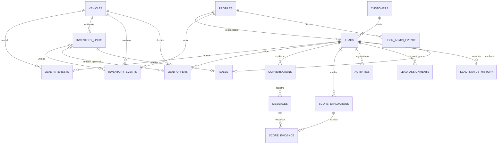

# Modelo de datos vigente — Pelucars backend V1

Fuente: [modelo recibido](referencias/modelo-backend-v1-2026-11-19.md), reconciliado con las conclusiones del [alcance V2](referencias/alcance-v2-2026-11-19.md). Los originales se conservan sin editar. El [diseño del 17/11](historico/modelo-de-datos-2026-11-17.md) es histórico y ya no define esta etapa.

Implementación al 20/11/2026: identidad (`profiles`, `user_admin_events`), catálogo/inventario (`vehicles`, `inventory_units`, `inventory_events`) y primera etapa comercial (`customers`, `leads`, `lead_interests`, `lead_assignments`, `lead_status_history`) aplicados en Supabase. Login, usuarios, inventario, clientes y bandejas reales conectados al frontend. Las migraciones y pruebas están en `supabase/`; ver [autenticacion.md](autenticacion.md), [frontend.md](frontend.md) y [crm.md](crm.md). Conversaciones, score, actividades, ofertas y ventas siguen como diseño, sin tablas ni integración creadas.

---

Actualizado el 20 de noviembre de 2026. Modelo para Supabase PostgreSQL, alineado con V1 de Pelucars. El documento incluye también campos de etapas futuras; las migraciones y el alcance de [crm.md](crm.md) identifican lo implementado. Los campos de atención/liberación, referencias a evaluaciones de score y automatizaciones de ingreso no se crean por anticipado en esta primera etapa comercial.

La separación entre catálogo y unidades físicas es la principal decisión de diseño propuesta. El negocio necesita conservar qué se busca aunque no exista stock y qué unidad concreta se vende. Las reglas pendientes de disponibilidad, retorno al bot e integración externa se mantienen como decisiones, sin valores arbitrarios.

# Conceptos del modelo

| Concepto | Qué representa |
| --- | --- |
| Cliente | Persona identificada inicialmente por teléfono. Puede tener varias búsquedas. |
| Oportunidad | Una búsqueda u operación comercial del cliente, con responsable y resultado propios. |
| Vehículo de catálogo | Modelo identificable, por ejemplo Toyota Hilux. Existe aunque nunca haya habido una unidad en inventario. |
| Unidad de inventario | Auto físico concreto: Hilux 2022, determinada versión, kilometraje, precio y estado. |
| Interés | Modelo o características que busca el cliente. Persiste aunque compre una alternativa. |
| Oferta | Vehículo alternativo o unidad que propone el vendedor; puede estar pendiente, aceptada o rechazada. |
| Venta | Resultado confirmado asociado a la unidad física vendida y a la oportunidad. |
| Actividad | Acción manual del vendedor, incluido cada intento de recontacto. |
| Evaluación de score | Puntaje completo calculado en un momento y con una versión de reglas. |
| Evidencia | Fragmento de mensaje y señal que explican esa evaluación. |

Una ficha Toyota Hilux sin unidades se muestra Sin stock, sin precio ni moneda. No se crea una unidad falsa con cantidad cero. Si ingresan dos Hilux, se agregan dos unidades. Si se vende una, la otra puede seguir disponible.

En esta propuesta, el catálogo agrupa por marca y modelo; año, versión y transmisión exactos pertenecen a las unidades. Los rangos deseados pertenecen al interés de la oportunidad. Esto admite búsquedas como Hilux sin año definido y evita inventar especificaciones.

# Relaciones principales

Las cardinalidades de venta representan V1: una venta confirmada por oportunidad y por unidad. Operaciones con varios vehículos, recompra y anulaciones requieren definir su tratamiento antes de ampliar esa restricción.

# Convenciones y estados

- Identificadores UUID; fechas y horas timestamptz, guardadas de forma consistente y mostradas en America/Buenos_Aires.
- Tablas mutables con created_at y updated_at. Historiales y evaluaciones se agregan sin sobrescribir eventos anteriores.
- Campos no conocidos usan NULL; no sustituirlos por cero, cadena vacía o valores inventados.
- Importes numeric(14,2), con moneda char(3). Presupuesto opcional; importe final de una venta confirmada, obligatorio.
- Claves foráneas para las relaciones; evitar borrado en cascada de usuarios, catálogo o clientes que destruya la historia.
- La base valida códigos, importes y relaciones, además de la validación del frontend.
- V1 no incluye tablas de zonas, sucursales, fotos, dashboards ni reglas de score editables por el usuario.

Estados comerciales confirmados: new_inquiry, follow_up, sold, lost, awaiting_stock. Etiquetas: Nueva consulta, En seguimiento, Vendido, Perdido y En espera de stock.

Estado de atención propuesto, independiente del comercial: queued, assigned, in_progress, released. Permite preparar la capacidad de asignación sin asumir que una oportunidad comercial abierta ocupa al vendedor indefinidamente. El evento que libera sigue pendiente.

Estados de unidad propuestos para V1: available, sold, withdrawn. Withdrawn representa retirada del inventario utilizable sin borrarla. Reservas no se incorporan automáticamente: requieren confirmar una funcionalidad de reserva.

# Usuarios y clientes

## profiles

| Campo | Tipo | Uso |
| --- | --- | --- |
| id | uuid PK y FK a auth.users | Identidad de acceso. |
| full_name | text, requerido | Nombre del usuario. |
| role | text, requerido | admin o seller; modificación privilegiada. |
| contact_phone | text, requerido para vendedores | Teléfono internacional E.164; obligatorio al crear y editar, también en demo. |
| contact_email | text, requerido para vendedores | Correo de contacto personal o laboral; puede coincidir con el de acceso. |
| is_enabled | boolean, requerido | Cuenta habilitada; deshabilitar no borra historial. |
| accepts_assignments | boolean, requerido | Disponibilidad operativa, distinta de la habilitación y de la carga. |
| created_at, updated_at | timestamptz | Trazabilidad básica. |

El correo de acceso se administra con Supabase Auth como fuente única. El correo de contacto se guarda en `profiles.contact_email` y será el destinatario para las futuras comunicaciones comerciales al vendedor; cambiarlo no modifica Auth. No se exige que sea único ni distinto del correo de acceso. Ambos son visibles sólo para el propio usuario y administradores. No almacenar contraseñas en profiles.

La migración `20261119154713_seller_contact_details.sql` agrega el contacto separado y exige ambos datos en nuevas altas y ediciones de vendedores. Las cuentas previas conservan los NULL históricos y su habilitación: no se inventan contactos. La restricción `seller_contact_required` se crea `NOT VALID` para no invalidar esas filas, pero se aplica a toda escritura nueva. Una vez completadas, validar la restricción mediante otra migración. Los administradores no están sujetos a esta obligación comercial.

La creación, edición de correo y deshabilitación de vendedores se hacen mediante backend autenticado que verifica rol admin. Credenciales administrativas de Supabase nunca llegan al navegador. Los usuarios no pueden cambiar su propio rol mediante updates directos.

## user_admin_events

id uuid PK; subject_user_id uuid FK profiles; actor_id uuid FK profiles; action text; changed_fields jsonb con valores anteriores/nuevos permitidos; occurred_at timestamptz.

Registra alta, edición y habilitación/deshabilitación. Solo administradores lo consultan. No guarda contraseñas, tokens ni secretos. Evita que una modificación de usuario borre su identidad histórica.

## customers

id uuid PK; full_name text NULL; phone_e164 text UNIQUE requerido; created_at y updated_at timestamptz.

Sin email de cliente en V1. El nombre puede no conocerse al llegar el primer mensaje. El teléfono normalizado evita duplicados básicos; teléfonos compartidos, reemplazos y fusión de clientes son excepciones que requieren procedimiento.

La asignación pertenece a la oportunidad, no a customers. El responsable anterior se consulta en el historial; falta decidir cómo elegirlo cuando hubo varios.

# Catálogo e inventario

## vehicles

| Campo | Tipo | Uso |
| --- | --- | --- |
| id | uuid PK | Ficha de catálogo. |
| brand, model | text, requeridos | Marca y modelo identificados. |
| search_name | text generado | Marca/modelo en minúsculas para búsqueda. Un índice único sobre ambas columnas normalizadas evita duplicados por mayúsculas o espacios. |
| origin | text | admin o intake; trazabilidad del origen. |
| needs_review | boolean | Indica identificación automática que requiere revisión. |
| created_by | uuid FK profiles, requerido en esta etapa | Administrador creador. La futura automatización requerirá revisar su identidad de servicio y esta restricción. |
| archived_at | timestamptz NULL | Retira la ficha de vistas habituales conservando relaciones. |
| created_at, updated_at | timestamptz | Fechas. |

No tiene precio, moneda ni booleano de stock editable: se obtienen de sus unidades. Una ficha sin unidades devuelve precio y moneda NULL y stock disponible 0 en la proyección del frontend.

La futura automatización de ingreso podrá crear fichas mediante una operación restringida aún no implementada. Hoy sólo los administradores crean fichas. No se fusionan modelos diferentes por similitud incierta ni se eliminan acentos al deduplicar.

Si no hay identificación suficiente (por ejemplo solo automático 2021), se conserva el texto y los criterios en lead_interests sin FK a catálogo. Para Toyota Hilux sin año sí se puede crear/reutilizar el modelo; no se inventa versión ni año.

## inventory_units

| Campo | Tipo | Uso |
| --- | --- | --- |
| id | uuid PK | Identidad de la unidad física. |
| vehicle_id | uuid FK vehicles, requerido | Modelo al que pertenece. |
| internal_code | text UNIQUE, generado | Identificador interno de stock `PEL-<número>`. No editable por las operaciones del sistema. Los códigos anteriores se conservan. |
| model_year | smallint NULL hasta completar | Año real, no el deseado por el cliente. |
| version, transmission | text NULL | Características conocidas. |
| transmission_kind | text generado, NULL si se desconoce | Categoría para filtros: automatic, manual u other; derivada de transmission sin alterar el texto existente. |
| mileage_km | integer NULL | Kilometraje no negativo. |
| listed_price | numeric(14,2) NULL | Precio publicado vigente, mayor que cero cuando existe. |
| currency | char(3) NULL | Obligatoria junto con el precio; ambos nulos o ambos informados. |
| status | text, requerido | available, sold o withdrawn. |
| received_at | date NULL | Fecha de ingreso al inventario, sin hora ni conversión de zona horaria. |
| created_at, updated_at | timestamptz | Fechas. |

Un registro representa una unidad real, no una cantidad por modelo. Marca/modelo vienen de vehicles. Si el importe no está informado, el panel lo indica; el precio de venta final sí debe informarse al confirmar.

La ficha agregada se considera En stock si tiene al menos una unidad available; Sin stock si no tiene ninguna. No tratar unidades sold o withdrawn como disponibles. No sumar precios en monedas diferentes ni mostrar un único precio si hay unidades con importes distintos.

La referencia del sistema externo y su identidad se definirán tras la reunión de integración. No asumir un external_id obligatorio ni crear un sincronizador ahora.

Implementado en `20261119162242_vehicle_inventory.sql`: código interno único sin distinguir mayúsculas/espacios exteriores; precio positivo con hasta dos decimales y moneda ARS/USD, ambos informados o ambos NULL. Año opcional de cuatro cifras y kilometraje entero no negativo. Versión y transmisión son textos opcionales. No se exige patente/VIN ni se inventa una identidad externa.

Revisión `20261120121950_inventory_codes_and_filters.sql`: `private.inventory_unit_code_seq` genera el código al insertar. La operación de alta ignora códigos proporcionados por clientes anteriores; la edición conserva la identidad original. No se renumeran unidades existentes. La secuencia es segura frente a altas concurrentes y puede tener saltos, incluso después de pruebas con rollback o altas fallidas; no es un contador de stock.

El selector ofrece Manual, Automática, Otra y Sin informar, y conserva una opción con el texto previo cuando éste difiere. `transmission_kind` reconoce también CVT/DSG como automáticas y mecánica como manual, sin distinción de mayúsculas o tildes; otros textos pertenecen a other, y NULL no se incluye en ninguna categoría específica. Índice de características por año, categoría y ficha.

Las funciones de lectura `search_vehicle_catalog` e `inventory_filter_years` son invoker, limitadas a authenticated y sujetas a RLS. La primera busca marca/modelo como texto literal, cuenta coincidencias de año/transmisión en una misma unidad y se pagina en servidor. Con stock disponible exige que la unidad coincidente esté disponible. Sin stock significa cero disponibles en toda la ficha; con stock Todos pueden coincidir unidades retiradas/vendidas. Los totales de la ficha siguen representando todas sus unidades, aunque el detalle muestre sólo las filtradas.

`20261120132113_inventory_price_filters.sql` amplía la búsqueda con una firma de ocho argumentos: añade `p_currency text`, `p_min_price numeric` y `p_max_price numeric`, conservando la firma previa para compatibilidad. Precio mínimo/máximo son inclusivos, independientes y no negativos; cualquier límite requiere ARS/USD. Un rango invertido, negativo o con moneda inválida devuelve cero coincidencias y el frontend muestra la validación. El importe y la moneda deben pertenecer a la misma unidad que cumple las demás características. Unidades sin precio no satisfacen filtros de precio/moneda. Índice por `(vehicle_id, currency, listed_price)`. No cambia datos de unidades ni aplica tasas de cambio; el widget/conversor está pendiente en [decisiones.md](decisiones.md).

Las operaciones públicas validan administrador habilitado en la base. `save_vehicle`, `save_inventory_unit` y `set_vehicle_archived` usan wrappers invoker e implementaciones privadas definer con search_path vacío. No hay escritura directa de usuarios autenticados. Vendedores habilitados consultan catálogo/unidades, incluidas fichas dadas de baja para conservar consulta histórica; la auditoría es sólo admin. La vista `vehicle_catalog` es security_invoker y devuelve conteos sujetos a RLS.

Las ediciones requieren el `updated_at` leído; un cambio concurrente se rechaza para evitar sobrescrituras. La baja del catálogo exige cero unidades disponibles. Alta/edición de unidades y baja de catálogo bloquean primero la misma ficha para serializar cambios de stock. Restaurar una ficha no cambia estados de sus unidades. Inventario sólo permite estados `available`/`withdrawn`; `sold` queda reservado al futuro flujo transaccional de ventas y una unidad vendida no puede reabrirse desde este módulo.

## inventory_events

id uuid PK; vehicle_id uuid FK vehicles requerido; unit_id uuid FK inventory_units NULL; actor_id uuid FK profiles requerido; action text; changes jsonb; occurred_at timestamptz.

Registra altas/ediciones de fichas, altas/ediciones de unidades y baja/restauración de catálogo dentro de la misma transacción. Conserva datos anteriores/nuevos. No hay borrado físico desde el sistema. La consulta visual de esta auditoría queda para una etapa posterior.

# Oportunidad e interés

## leads

| Campo | Tipo | Uso |
| --- | --- | --- |
| id | uuid PK | Oportunidad. |
| customer_id | uuid FK customers, requerido | Cliente. |
| assigned_to | uuid FK profiles NULL | Responsable actual; NULL en pendientes. |
| source | text | whatsapp_bot para el futuro ingreso del bot; demo para la carga explícita de pruebas autorizada el 20/11. No habilita alta manual desde el panel. |
| reference_number | integer UNIQUE, identity | Referencia humana OP-000123. UUID sigue como PK; la secuencia puede tener saltos. Implementado el 20/11. |
| commercial_status | text, requerido | Uno de los cinco estados. |
| attention_state | text, requerido | Estado operativo propuesto; regla de liberación pendiente. |
| summary | text NULL | Resumen privado de la necesidad. |
| budget_min, budget_max | numeric(14,2) NULL | Presupuesto declarado, no inferido. |
| budget_currency | char(3) NULL | Requerida si hay importe; no convertir monedas automáticamente. |
| financing_needed | boolean NULL | Sí, no o desconocido. |
| trade_in_details | text NULL | Usado ofrecido, sin incorporarlo al stock. |
| purchase_timeframe | text NULL | Plazo expresado por el cliente. |
| waiting_since | timestamptz NULL | Inicio de la espera para ordenar la cola. |
| attention_started_at, attention_released_at | timestamptz NULL | Hitos operativos, cuando correspondan. |
| closed_at | timestamptz NULL | Cierre vendido/perdido. En espera de stock permanece abierto. |
| loss_reason | text NULL | Motivo de pérdida; no equivale a falta de stock con interés vigente. |
| created_at, updated_at | timestamptz | Fechas. |

Checks: presupuestos no negativos; mínimo no mayor que máximo; estado válido. La coherencia de cierre, venta y atención se valida en operaciones del backend y restricciones de base.

No imponer una única oportunidad abierta por cliente: el negocio admite varias búsquedas. Tampoco crear nuevas oportunidades para cada mensaje. Un cliente recurrente puede originar una nueva sin reabrir ni sobrescribir la anterior.

El score actual se obtiene de la última evaluación válida, no de un campo editable por el vendedor. Las consultas de detalle, summary, interés y presupuesto se restringen al responsable actual/admin.

## lead_interests

id uuid PK; lead_id uuid FK leads requerido; vehicle_id uuid FK vehicles NULL; requested_text text requerido; year_min y year_max smallint NULL; requested_version y transmission text NULL; is_primary boolean; status text (active, replaced); created_at y updated_at timestamptz.

Conserva modelo y características buscadas. Un índice parcial permite como máximo un interés primario activo por oportunidad; admite alternativas expresadas por el cliente. Año mínimo no supera al máximo.

Un cambio real de búsqueda se registra marcando el interés anterior como replaced y agregando el nuevo, conservando el texto original. Comprar una alternativa no reemplaza la búsqueda original: se registra en ofertas y venta.

Esta tabla reemplaza la relación simple lead_vehicles del diseño anterior, porque necesitamos guardar también búsquedas genéricas y criterios.

# Ofertas y venta

## lead_offers

id uuid PK; lead_id uuid FK leads; vehicle_id uuid FK vehicles requerido; inventory_unit_id uuid FK inventory_units NULL; offered_by uuid FK profiles; response text (pending, accepted, rejected); response_note text NULL; offered_at timestamptz; responded_at timestamptz NULL.

Registra alternativas propuestas manualmente por el vendedor. Si especifica una unidad, su vehicle_id debe coincidir con el de la oferta. Puede proponerse un modelo y elegir la unidad física más adelante. Una aceptación no equivale por sí sola a una venta.

## sales

| Campo | Tipo | Uso |
| --- | --- | --- |
| id | uuid PK | Venta confirmada. |
| lead_id | uuid FK leads UNIQUE | Oportunidad que originó la venta. |
| inventory_unit_id | uuid FK inventory_units UNIQUE | Unidad física vendida. |
| offer_id | uuid FK lead_offers NULL | Oferta aceptada, si se registró una. |
| seller_id | uuid FK profiles | Vendedor al que se atribuye la venta. |
| recorded_by | uuid FK profiles | Persona que confirma; puede ser administrador. |
| amount | numeric(14,2), requerido y positivo | Precio final, distinto del precio publicado. |
| currency | char(3), requerido | Moneda de venta. |
| sold_at, created_at | timestamptz | Fecha comercial y fecha de registro. |

La venta se confirma en una transacción: verifica permiso, bloquea unidad y oportunidad, comprueba disponibilidad, inserta la venta, marca la unidad sold y la oportunidad sold, y agrega el historial de estado con la evaluación de score de ese momento.

Si hay offer_id, debe pertenecer a la misma oportunidad, estar aceptada y corresponder al mismo modelo/unidad vendida. Puede validarse con claves compuestas y lógica transaccional.

No duplicar customer_id si se obtiene de la oportunidad. No cambiar la búsqueda de Hilux a Ranger al vender la alternativa. No permitir que un segundo vendedor venda la misma unidad.

Anular/corregir ventas requiere una operación explícita pendiente de definir. No implementar retorno de stock por un cambio genérico de estado.

# Conversaciones y mensajes

## conversations

id uuid PK; lead_id uuid FK leads; provider text; business_phone_id text; channel text; started_at timestamptz; ended_at timestamptz NULL; bot_state text (collecting, waiting_assignment, handed_off, stopped); bot_messages_count smallint entre 0 y 3; bot_stop_reason text NULL; handoff_at timestamptz NULL; handed_off_to uuid FK profiles NULL.

La recepción agrupa mensajes y aplica el límite de tres envíos. El fin de la intervención del bot no prueba que el vendedor haya atendido ni que el cliente haya comprado. No presupone acceso a la conversación privada posterior.

El contador no se reinicia por cada mensaje ni por un reintento del webhook. Una nueva búsqueda requiere una nueva decisión de ingreso según D07; conservar el enlace de cada mensaje a la conversación original.

## messages

id uuid PK; conversation_id uuid FK conversations; provider_message_id text NULL; provider text; business_phone_id text; direction text (inbound, outbound); sender_kind text (customer, bot); message_type text; body text NULL; sent_at timestamptz NULL; received_at timestamptz NULL; delivery_status text NULL; outbound_dedup_key text NULL UNIQUE; created_at timestamptz.

Unicidad del mensaje externo por provider, business_phone_id y provider_message_id cuando esté informado. Los mensajes salientes pendientes aún pueden no tener el ID del proveedor.

La combinación de claves evita registrar dos veces un webhook; las confirmaciones de entrega actualizan el mensaje, no crean otra oportunidad. El contador de bot y el envío requieren control de concurrencia y reconciliación de fallos; no confiar solo en el prompt.

V1 guarda los mensajes recibidos por la integración del bot. No incluye seller_id ni mensajes privados del vendedor: ese emisor solo se agregaría con una integración real posterior.

El tipo permite identificar texto/audio/imagen u otros eventos. Transcripción de audio y análisis de imágenes no quedan implementados por disponer de ese campo; requieren alcance específico. No exponer cuerpos o enlaces de contenido a vendedores sin asignación.

# Score y evidencia

## score_evaluations

id uuid PK; lead_id uuid FK leads; score smallint entre 0 y 100; rules_version text requerido; rules_snapshot jsonb requerido; evaluated_at timestamptz; evaluated_through_message_id uuid FK messages NULL; extraction_model text NULL.

rules_snapshot conserva los criterios efectivamente usados aunque luego cambie el código/configuración. extraction_model identifica la versión del modelo de extracción si corresponde. El mensaje límite debe pertenecer a la misma oportunidad.

Las reglas iniciales viven en código/configuración versionada; no hay editor visual ni tabla de reglas administrable en V1. El total y sus evidencias se guardan atómicamente. Evaluaciones anteriores se conservan.

## score_evidence

id uuid PK; evaluation_id uuid FK score_evaluations; message_id uuid FK messages; signal_code text; quoted_text text; points_applied smallint.

Cada fila explica una señal aplicada. El mensaje debe ser del cliente y pertenecer a la misma oportunidad de la evaluación. Validar que el fragmento respalde la señal, incluida la negación.

Restricción propuesta UNIQUE(evaluation_id, signal_code) para criterios que puntúan una sola vez: elegir el mensaje que mejor respalda cada señal. Si se necesitan varias fuentes por señal, se ajusta antes de permitir sumas repetidas.

El score total se deriva de criterios únicos según rules_snapshot; la regla de límite 0–100 también se conserva. No sumar entre evaluaciones: cada una es el total de un momento.

Ejemplo conceptual: evaluación 45; evidencia compra próxima 20 y visita 25. Una evaluación posterior puede dar 60, no 105.

## Datos para análisis futuro

- lead_assignments apunta a la evaluación vigente al tomar/asignar la oportunidad.
- lead_status_history apunta a la evaluación vigente al cerrar vendido/perdido.
- Si aún no había evaluación, la referencia queda NULL; no inventar score 0.
- Para comparar vendedores, usar el score conocido en la asignación y vendedor histórico, no solo responsable o score actuales.
- Las bandas de score y cohortes para KPI se definirán con la gestión. No construir el dashboard ahora.

# Actividades y seguimiento

## activities

id uuid PK; lead_id uuid FK leads; performed_by uuid FK profiles; activity_type text (whatsapp_contact, call, visit, note); purpose text (initial_contact, follow_up, coordination, other); status text (completed, scheduled, cancelled); scheduled_at timestamptz NULL; completed_at timestamptz NULL; outcome text NULL; notes text NULL; created_at y updated_at timestamptz.

V1 confirmado: registrar actividades realizadas, notas y programar actividades (conclusión D10 del alcance). Esto no incluye recordatorios automáticos.

completed exige completed_at; scheduled exige scheduled_at y no se cuenta como realizado. Definir resultados consistentes como no_response, contact_made y visit_completed. Una nota no es un intento de contacto.

Intentos de recontacto = actividades realizadas con purpose=follow_up y tipo de contacto, no cantidad de mensajes. Contactos efectivos = subconjunto con resultado de contacto logrado. Las ediciones no deben crear nuevos intentos por duplicación.

Solo responsable/admin puede registrar o consultar. La interfaz puede llamar Historial a la línea de tiempo que combina actividades y eventos: no hay una segunda carga para registrar el recontacto.

En espera de stock, el vendedor puede registrar un intento sin cambiar estado si no hubo contacto. Cuando retoma la negociación, cambia explícitamente a En seguimiento y queda el historial.

# Asignaciones y cambios de estado

## lead_assignments

id uuid PK; lead_id uuid FK leads; previous_assignee_id uuid FK profiles NULL; assignee_id uuid FK profiles NULL; mode text; actor_id uuid FK profiles NULL; reason text NULL; score_evaluation_id uuid FK score_evaluations NULL; occurred_at timestamptz.

mode distingue automatic, manual_claim, returning_customer, admin_assignment y reassignment. La asignación manual y la reasignación administrativa están confirmadas por D11. actor_id es NULL para automatización; la modalidad identifica ese origen. Una referencia a score debe corresponder al mismo lead.

El historial no es la fuente de autorización actual: el permiso se determina con leads.assigned_to. Haber atendido antes no habilita acceso permanente si luego cambia el responsable.

## lead_status_history

id uuid PK; lead_id uuid FK leads; status_field text (commercial_status, attention_state); old_value text NULL; new_value text; actor_id uuid FK profiles NULL; source text (user, automation); reason text NULL; score_evaluation_id uuid FK score_evaluations NULL; changed_at timestamptz.

Distingue cambio comercial de cambio operativo. Al entrar en sold/lost registra evaluación vigente y fecha de cierre. Al pasar a awaiting_stock no cierra la oportunidad ni la elimina del catálogo.

Las filas las genera la operación validada, no se crean arbitrariamente desde el navegador. Una eventual reapertura conserva el evento previo de pérdida aunque closed_at actual vuelva a NULL.

# Proyecciones de consulta y permisos

Implementado el 20/11: `lead_notifications` contiene `id uuid PK`, `lead_id uuid FK leads`, `assignment_id uuid UNIQUE FK lead_assignments`, `recipient_id uuid FK profiles`, `created_at timestamptz` y `read_at timestamptz NULL`. Los eventos de asignación crean avisos internos; una toma voluntaria propia no los duplica. Sólo el destinatario habilitado que todavía sea responsable puede leerlos o marcarlos leídos. Al reasignar, los avisos previos se cierran. No incluye envío de correo/WhatsApp. Detalles de las funciones y del sondeo del frontend en [crm.md](crm.md).

| Consulta o acción | Vendedor habilitado | Administrador |
| --- | --- | --- |
| Catálogo y stock | Lectura. | Lectura y ABM. |
| Bandeja pendiente | Sólo identificador de consulta, fecha/hora de ingreso y tiempo de espera, e indicación **Sin asignar**; acción **Tomar oportunidad**. Sin nombre ni detalle comercial. | Detalle completo. |
| Tomar pendiente | Operación atómica, sin tope provisional aprobado para la demo. | Puede tomar o asignar manualmente. |
| Oportunidad asignada a sí mismo | Detalle, actividades, ofertas y cambios permitidos. | Todas. |
| Oportunidad de otro vendedor | Sin acceso. | Acceso. |
| Lista de oportunidades dentro del vehículo | Solo las propias. No enlazar pendientes con modelo antes de tomar si revela información restringida. | Todas, incluidos pendientes. |
| Ficha del cliente | Identidad cuando exista oportunidad propia; relaciones y contadores solo de oportunidades autorizadas. | Historial completo. |
| Evaluaciones y mensajes | Solo de oportunidades propias. | Todas. |
| Datos privados de otros vendedores | Sin acceso general. | Gestión de usuarios. |
| Modificar score, rol o responsable directamente | Prohibido. | Mediante operaciones autorizadas, no edición libre de score. |

Implementación propuesta:

- RLS sobre tablas privadas y consultas con autorización en servidor. Las tablas base de leads no dan lectura completa de pendientes al vendedor.
- Una función list_pending_leads devuelve una lista explícita de columnas mínimas. Si usa SECURITY DEFINER, verificar usuario, habilitación y rol, fijar search_path y limitar EXECUTE. No usar SELECT \* ni devolver datos privados para ocultarlos después con CSS.
- D05 aprobado e implementado el 20/11: devolver únicamente identificador de consulta, fecha/hora de ingreso a la bandeja (para mostrar también el tiempo de espera) e indicación operativa **Sin asignar**. No devolver nombre, contacto, interés, stock relacionado, presupuesto, urgencia, score, mensajes, resumen ni historial de compras. No exponer el estado comercial: **En espera de stock**, por ejemplo, revela información excluida. La acción **Tomar oportunidad** habilita el detalle únicamente después de confirmar la asignación atómica al vendedor.
- Búsquedas, filtros, ordenamientos y eventos de la bandeja deben respetar esa misma proyección, sin permitir deducir información comercial oculta.
- Vistas normales con seguridad del invocador y RLS; no crear una vista con privilegios del dueño que filtre solo en la interfaz.
- El detalle por vehículo/clientes y sus conteos debe aplicar el mismo permiso de las oportunidades. No filtrar solo el enlace y dejar visibles los datos.
- Notificaciones en tiempo real para pendientes sin payload privado; volver a consultar la proyección segura. No publicar mensajes o scores completos en un canal compartido.
- Tras deshabilitación o cambio de responsable, revalidar acceso y limpiar caché del cliente. Consultas directas con JWT antiguo deben quedar bloqueadas por is_enabled.
- Una automatización técnica puede crear catálogo desde la recepción; no debe permitir que un usuario común use esa credencial ni suministre un actor arbitrario.

# Operaciones del backend

## Ingresar una consulta

1. Validar origen del webhook y deduplicar el evento.
2. Buscar/crear cliente por teléfono normalizado.
3. Resolver conversación existente frente a nueva búsqueda; no aplicar todavía una constante de siete días sin cerrar D07.
4. Crear o actualizar la oportunidad correspondiente y registrar el mensaje.
5. Extraer interés: si hay marca/modelo confiables, normalizar y reutilizar/crear la ficha de catálogo; insertar el interés. Si la búsqueda es genérica, conservarla sin catálogo.
6. Evaluar con reglas versionadas y guardar evidencias.
7. Asignar o poner en espera según disponibilidad y reglas aprobadas.
8. Registrar evento de asignación, preparar aviso y continuar/finalizar bot sin exceder tres mensajes.

La transacción local y el envío externo tienen fallos distintos. Para la implementación, usar una cola o registro durable de envíos e idempotencia; su detalle técnico se especifica en la fase de integración. No mantener una transacción SQL abierta mientras espera al proveedor.

## Tomar y asignar

Bloquear la oportunidad y comprobar que sigue sin responsable; verificar usuario habilitado; evaluar la política; actualizar assigned_to y atención; agregar historial y referencia de score en una transacción.

La asignación automática también bloquea o serializa la capacidad del vendedor: dos consultas simultáneas no deben seleccionar al mismo vendedor como libre sobre un estado obsoleto. Orden de espera por waiting_since y desempate estable.

No dar al vendedor permiso general para actualizar assigned_to. Al tomar, devolver el detalle únicamente después de confirmar la transacción.

## Confirmar venta

Verificar responsable/admin, bloquear oportunidad y unidad, validar stock, registrar sales y actualizar ambos estados con historial en una transacción. Repetir una solicitud no debe duplicar ventas. Si otra operación vendió la unidad, informar conflicto.

## Registrar llegada de stock

Administrador agrega una unidad real al modelo existente. El stock calculado cambia y las oportunidades previas siguen vinculadas. Se muestran como candidatas al revisar la ficha; no crear leads nuevos, enviar mensajes ni reabrir automáticamente las oportunidades.

## Administrar vendedores

Backend valida admin, opera Supabase Auth y profiles, y registra evento. Si el alta externa y la inserción de perfil no finalizan juntas, reconciliar el estado y evitar dejar una cuenta con privilegios incompletos. Solo habilitar después de completar los datos necesarios.

Deshabilitar bloquea futuras asignaciones y el acceso. No borra ni reasigna automáticamente las oportunidades existentes. Una nueva consulta de un cliente recurrente cuyo responsable previo esté deshabilitado vuelve a la bandeja (conclusión D04); las reasignaciones administrativas están incluidas (D11).

En la primera migración no hay altas públicas ni perfiles creados desde metadata editable. Un alta en Auth sin perfil queda sin acceso. `register_seller` inserta perfil y auditoría en una transacción después de verificar al administrador. Los dos sistemas no comparten transacción: un fallo intermedio requiere conciliación y no un borrado automático. `bootstrap_account` es exclusivo de la credencial de servidor para las cuentas iniciales; registra `action=bootstrap`, con el propio usuario como actor técnico del alta inicial. Los roles de administradores no se editan desde el formulario de vendedores. `accepts_assignments` inicia en false hasta definir y habilitar el flujo operativo.

# Índices y restricciones para las migraciones

- UNIQUE customers(phone_e164), vehicles(normalized_key), inventory_units(internal_code).
- leads(assigned_to, commercial_status); leads(customer_id, created_at DESC).
- Índice parcial de leads(waiting_since, id) para assigned_to IS NULL y commercial_status IN (new_inquiry, follow_up, awaiting_stock).
- inventory_units(vehicle_id, status).
- lead_interests(vehicle_id, lead_id), lead_offers(vehicle_id, lead_id).
- conversations(lead_id, started_at), messages(conversation_id, created_at).
- UNIQUE parcial del ID externo de mensaje y UNIQUE outbound_dedup_key cuando exista.
- score_evaluations(lead_id, evaluated_at DESC, id) y score_evidence(evaluation_id).
- activities(lead_id, completed_at DESC), lead_assignments(lead_id, occurred_at), lead_status_history(lead_id, changed_at).
- Índice parcial para una sola búsqueda primaria activa por lead.
- UNIQUE sales(lead_id) y sales(inventory_unit_id) para las ventas confirmadas de V1.
- FK compuestas o validación transaccional para asegurar misma oportunidad en evidencia/evaluación/mensaje y misma unidad/modelo en oferta/venta.
- Borrado RESTRICT o archivado donde existan referencias históricas. No destruir relaciones con usuarios deshabilitados ni vehículos vendidos.

Los índices se ajustarán a consultas y volumen al implementar; no sustituyen la autorización ni la atomicidad.

# Comprobación de los tres casos

| Caso | Registros relevantes | Resultado |
| --- | --- | --- |
| Corolla 2022 en stock | Interés apunta a Corolla con año 2022; venta a una unidad Corolla 2022 available. | Lead sold, unidad sold; otras unidades Corolla no cambian. |
| Hilux buscada y Ranger vendida | Interés Hilux; oferta Ranger accepted; venta a unidad Ranger. | Búsqueda Hilux se conserva, solo unidad Ranger queda sold. |
| Hilux buscada sin stock y Ranger rechazada | Ficha Hilux sin unidades, interés vinculado, oferta Ranger rejected. | Lead awaiting_stock, sin venta; no disminuye stock de Ranger. |
| Llega Hilux después | Nueva unidad Hilux available en ficha existente. | Se consulta la lista autorizada; responsable registra recontacto y retoma gestión si corresponde. |

Para demanda no satisfecha, contar intereses activos en oportunidades awaiting_stock. No contar como demanda vigente una Hilux de alguien que ya compró Ranger, aunque conserve la búsqueda histórica.

El listado por ficha puede unir intereses, ofertas y ventas, mostrando etiquetas Buscado, Ofrecido o Vendido y deduplicando la oportunidad. Así se explica por qué está asociada. Para vendedores aplica RLS antes de contar o listar.

# Validación prevista antes de implementar

1. Dos solicitudes crean el mismo modelo a la vez: queda una ficha y dos intereses válidos.
2. Búsqueda genérica: no se inventa marca, precio ni unidad.
3. Dos vendedores toman la misma oportunidad: solo uno recibe el detalle.
4. Vendedor intenta acceder a score o chat pendiente por URL/API: denegado.
5. Vendedor consulta ficha de vehículo o cliente: no recibe oportunidades ajenas ni sus contadores.
6. Admin ve las asociaciones completas.
7. Cuenta deshabilitada intenta usar una sesión previa: denegado; no recibe asignación.
8. Venta alternativa conserva interés original y actualiza solo la unidad comprada.
9. Dos ventas intentan usar la misma unidad: una falla sin dejar un cierre parcial.
10. Llegada de stock no envía mensajes ni cambia estados por sí sola.
11. Reintento de webhook no duplica cliente, mensaje, lead o respuesta.
12. Score histórico de asignación y cierre no cambia al recalcular.
13. Actividad realizada se cuenta una vez; nota o actividad programada no cuenta como recontacto.
14. Un retorno al bot y varios mensajes seguidos respetan la política de nueva oportunidad aprobada.

Estas son verificaciones a implementar sobre las migraciones y operaciones. El documento no constituye evidencia de pruebas ejecutadas.

# Pendientes que condicionan el backend

- Aprobar definitivamente la granularidad del catálogo propuesta. En espera de stock ya está confirmado.
- D01/D02/D03: liberación, capacidad y control de disponibilidad.
- D04/D06 resueltos: se elige al responsable actual de la consulta más reciente (ingreso y UUID de desempate). Si está deshabilitado o la más reciente no tiene responsable, vuelve a bandeja. El nuevo responsable ve el detalle existente y el anterior pierde acceso. Sigue pendiente D07, que decide cuándo crear la nueva consulta.
- D07: condición temporal de siete días y excepciones, sin confundir mensaje con búsqueda.
- D08/D09: reglas de calificación y orden de recepción/asignación. Confirmado: el vendedor obtiene el teléfono del panel y contacta al cliente. Falta reconciliar la asignación de pendientes al liberarse un vendedor con la conclusión D09 que indica toma voluntaria cuando no hay libres.
- D10: las actividades programadas están aprobadas; definir edición y cancelación sin implementar recordatorios.
- D13: carga inicial/API e identificación externa.
- D15: si puede devolver una oportunidad después de ver su score y quién lo autoriza.
- D17: anulación/corrección de venta y stock.

Orden sugerido para comenzar: identidad/permisos; catálogo/unidades/intereses; oportunidades y bandeja segura; actividades y venta transaccional; recepción y score. Seed, conexión externa y despliegue se autorizan por etapa, no se ejecutan por aprobar este diseño.
